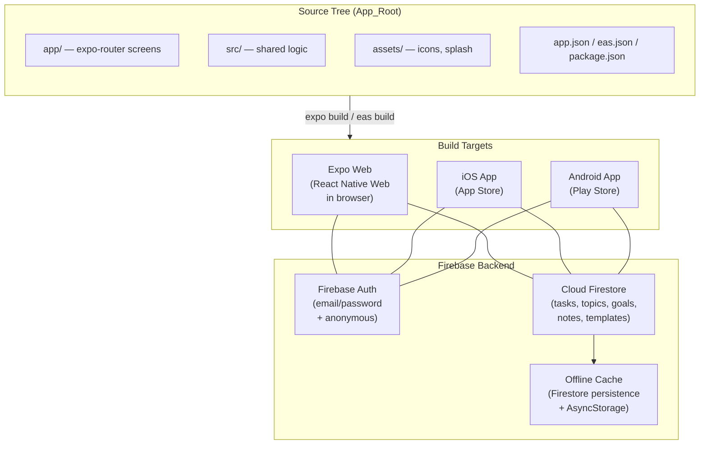
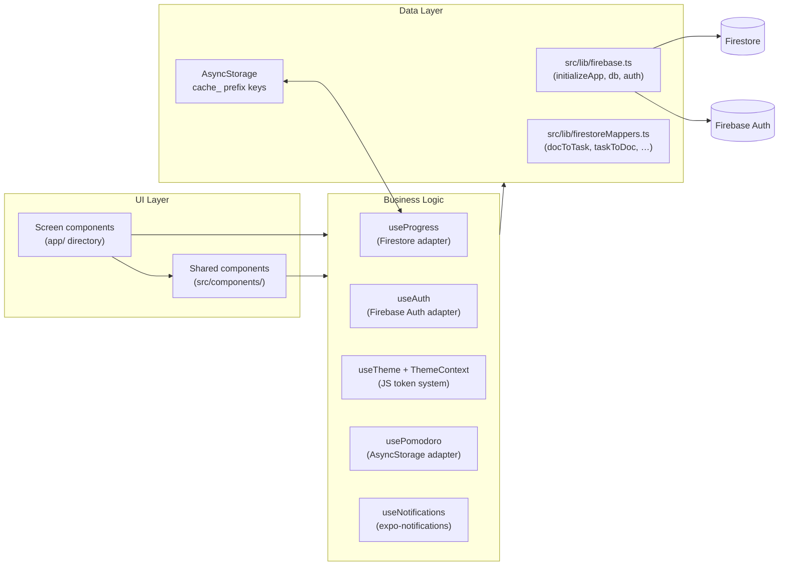
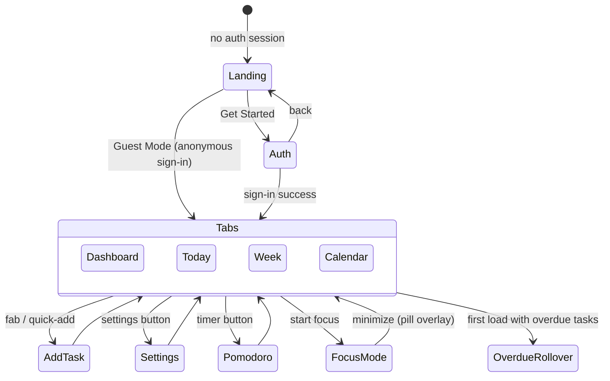

# Design Document — React Native Migration

## Overview

This document covers the technical design for migrating the Daily Planner from a React 19 + Vite web-only SPA to a single Expo SDK 52 + React Native codebase that ships to iOS, Android, and the web from one source tree.

The existing `frontend/` directory is replaced entirely by a new Expo project at the repository root. The Supabase backend (PostgreSQL + Supabase Auth) is replaced by Firebase (Firestore + Firebase Auth). All existing business logic in hooks, utilities, and parsing code is preserved — only the platform-specific I/O calls change: `localStorage` → `AsyncStorage`, Supabase client calls → Firebase SDK calls.

The result is a single repo with one `package.json`, one `app.json`, and one CI/CD pipeline that produces three distribution targets.

---

## Architecture

### Single Codebase → Three Targets



### Runtime Layer Diagram



---

## Directory Structure

The new project replaces `frontend/` entirely. The top-level layout of the Expo project (at the repo root or in a top-level `app/` directory named `App_Root`) is:

```
App_Root/
├── app/                          # expo-router file-based screens
│   ├── _layout.tsx               # Root layout: ThemeProvider, GestureHandler, Auth gate
│   ├── index.tsx                 # Landing page (unauthenticated entry)
│   ├── auth.tsx                  # Auth screen (sign-in / sign-up / reset)
│   ├── (tabs)/
│   │   ├── _layout.tsx           # Tab navigator (Dashboard, Today, Week, Calendar)
│   │   ├── index.tsx             # Dashboard tab
│   │   ├── today.tsx             # Today tab
│   │   ├── week.tsx              # Week tab
│   │   └── calendar.tsx          # Calendar tab
│   └── (modals)/
│       ├── add-task.tsx          # Add/Edit Task bottom sheet
│       ├── settings.tsx          # Settings screen
│       ├── pomodoro.tsx          # Pomodoro Timer modal
│       ├── focus-mode.tsx        # Focus Mode overlay
│       ├── overdue-rollover.tsx  # Overdue Rollover modal
│       └── feedback.tsx          # Feedback page
├── src/
│   ├── components/               # Cross-platform shared components
│   │   ├── GoalSetting.tsx
│   │   ├── Heatmap.tsx
│   │   ├── BestHoursChart.tsx
│   │   ├── LineChart.tsx
│   │   ├── TopicBalance.tsx
│   │   ├── PomodoroTimer.tsx
│   │   ├── FocusMode.tsx
│   │   ├── TaskItem.tsx          # Swipeable task row
│   │   ├── CommandPalette.tsx
│   │   ├── TimeBlockView.tsx
│   │   ├── Sidebar.tsx           # Web-only sidebar (imported via .web.tsx extension)
│   │   ├── NavigationBar.tsx     # Mobile bottom tab bar wrapper
│   │   ├── Confetti.tsx
│   │   ├── AppTour.tsx
│   │   └── …                     # remaining components (one-to-one with frontend/)
│   ├── hooks/
│   │   ├── useProgress.ts        # Adapted: Supabase → Firestore onSnapshot
│   │   ├── useAuth.ts            # Adapted: Supabase Auth → Firebase Auth
│   │   ├── useTheme.tsx          # Adapted: CSS vars → JS token object
│   │   ├── usePomodoro.ts        # Adapted: localStorage → AsyncStorage
│   │   ├── useNotifications.ts   # Adapted: Web Notification API → expo-notifications
│   │   ├── useKeyboardShortcuts.ts  # Web-only; no-ops on native
│   │   ├── useAccessibility.ts   # Adapted: DOM → AccessibilityInfo RN API
│   │   └── useLocalStorage.ts    # Replaced with AsyncStorage wrapper
│   ├── lib/
│   │   ├── firebase.ts           # initializeApp, db, auth — single init
│   │   ├── firestoreMappers.ts   # docToTask, taskToDoc, docToTopic, docToNote, docToGoals, docToTemplate
│   │   └── utils.ts              # fmtDuration, parseDuration — zero changes
│   └── theme/
│       ├── tokens.ts             # Dark/light token maps
│       └── index.ts              # Re-exports ThemeContext, useTheme, tokens
├── assets/
│   ├── icon.png                  # 1024×1024 px
│   └── splash.png                # 1242×2688 px
├── DEPENDENCIES.md               # Version resolution log (Req 2.6)
├── app.json                      # Expo config
├── eas.json                      # EAS Build profiles
├── package.json                  # Single root package.json
└── tsconfig.json
```

**Platform-specific file branching:** React Native resolves `.native.tsx` over `.tsx` on iOS/Android and `.web.tsx` over `.tsx` on the web platform. The sidebar is only rendered on web, so:

```
src/components/Sidebar.web.tsx     ← web-only sidebar
src/components/Sidebar.native.tsx  ← returns null (no-op)
```

Navigation-bar rendering follows the same pattern or a `Platform.OS` check inside the tab `_layout.tsx`.

---

## Firebase Data Model

### Firestore Collection Paths

All user data lives under `users/{userId}/` to enforce security-rule isolation.

| Collection path | Document ID | Purpose |
|---|---|---|
| `users/{uid}/tasks` | JS-generated UUID | Task records |
| `users/{uid}/topics` | topic name slug | User-defined topics |
| `users/{uid}/notes` | ISO date `YYYY-MM-DD` | Daily notes |
| `users/{uid}/goals/daily` | fixed `"daily"` | Daily task target + extra goals |
| `users/{uid}/templates` | JS-generated UUID | Task templates |
| `users/{uid}/archived_tasks` | JS-generated UUID | Archived task records |

### Task Document Schema

```ts
// Firestore document (snake_case stored, camelCase in app)
interface TaskDoc {
  id: string                        // matches document ID
  user_id: string
  title: string
  description: string
  topic: string
  duration: number                  // minutes
  actual_duration: number | null
  date: string                      // YYYY-MM-DD
  original_date: string | null
  due_time: string | null           // HH:MM
  completed: boolean
  completed_at: string | null       // ISO 8601
  created_at: string                // ISO 8601
  note: string
  priority: 'high' | 'medium' | 'low' | null
  depends_on: string[]              // task IDs
  subtasks: SubtaskDoc[]
  recurrence: 'none' | 'daily' | 'weekly' | 'weekdays' | 'custom'
  recurrence_end_date: string | null
  recurrence_parent_id: string | null
  custom_recurrence_days: number[] | null  // 0=Sun…6=Sat
}

interface SubtaskDoc {
  id: string
  title: string
  completed: boolean
}
```

### Goals Document Schema

```ts
interface GoalsDoc {
  daily_task_target: number
  extra_goals: ExtraGoal[]
}

interface ExtraGoal {
  id: string
  type: 'min_tasks' | 'min_time' | 'all_priority'
  value?: number
  topic?: string
  priority?: 'high' | 'medium' | 'low'
}
```

### Template Document Schema

```ts
interface TemplateDoc {
  id: string
  user_id: string
  name: string
  title: string
  description: string
  topic: string
  duration: number
  due_time: string | null
  subtasks: SubtaskDoc[]
  recurrence: string
  custom_recurrence_days: number[] | null
  created_at: string
}
```

---

## Navigation Architecture

### expo-router File Tree

The navigation hierarchy maps directly onto the `app/` directory:

```
app/
  _layout.tsx           → Root Stack (wraps everything)
    index.tsx           → Landing (shown when no auth session)
    auth.tsx            → Auth screen (sign-in / sign-up / reset)
    (tabs)/
      _layout.tsx       → Tab Navigator
        index.tsx       → Dashboard
        today.tsx       → Today
        week.tsx        → Week
        calendar.tsx    → Calendar
    (modals)/
      add-task.tsx      → presented:modal
      settings.tsx      → presented:modal
      pomodoro.tsx      → presented:modal
      focus-mode.tsx    → persistent overlay (custom layout)
      overdue-rollover.tsx → presented:modal
      feedback.tsx      → presented:fullscreen
```

### Navigation Flow Diagram



### Platform Navigation Branching

The tab `_layout.tsx` renders the navigation chrome conditionally:

```tsx
// app/(tabs)/_layout.tsx (sketch)
import { Platform, useWindowDimensions } from 'react-native'
import { Tabs } from 'expo-router'
import Sidebar from '@/src/components/Sidebar' // resolves to .web.tsx or .native.tsx

export default function TabLayout() {
  const { width } = useWindowDimensions()
  const useWebSidebar = Platform.OS === 'web' && width > 768

  return useWebSidebar
    ? <SidebarLayout />        // web ≥ 768px: sidebar + content area
    : <Tabs tabBar={…} />      // mobile / web <768px: bottom tab bar
}
```

The `Sidebar.web.tsx` component replicates the full sidebar from the existing `App.jsx` using RN `View`, `Pressable`, and `Text` primitives with theme tokens. `Sidebar.native.tsx` returns `null`.

### Android Back / iOS Swipe

expo-router's built-in stack navigator handles Android back and iOS swipe-back automatically for screens declared `presentation: 'modal'`. Unsaved form state in Add/Edit Task is preserved via a `useRef` that is checked in a `beforeRemove` listener — if the form is dirty, a confirmation alert is shown before discarding.

---

## Theme System Design

### Why JS Tokens

React Native does not support CSS custom properties. The existing `var(--accent-blue)` pattern is replaced by a JS object (`tokens`) that maps token names to concrete color strings resolved at runtime based on the active theme.

### Token Map

```ts
// src/theme/tokens.ts
export const DARK_TOKENS = {
  bgPrimary:      '#0f1117',
  bgSecondary:    '#1a1d27',
  bgInput:        '#232635',
  borderPrimary:  '#2e3349',
  borderSecondary:'#1e2235',
  textPrimary:    '#f1f5f9',
  textSecondary:  '#94a3b8',
  textMuted:      '#475569',
  accentBlue:     '#3b82f6',   // overridden by accentColor
  accentGreen:    '#22c55e',
  accentOrange:   '#f97316',
  accentRed:      '#ef4444',
  accentPurple:   '#a855f7',
  accentPrimary:  '#3b82f6',   // alias of accentBlue, overridden by accentColor
} as const

export const LIGHT_TOKENS = {
  bgPrimary:      '#f8fafc',
  bgSecondary:    '#ffffff',
  bgInput:        '#f1f5f9',
  borderPrimary:  '#e2e8f0',
  borderSecondary:'#cbd5e1',
  textPrimary:    '#0f172a',
  textSecondary:  '#475569',
  textMuted:      '#94a3b8',
  accentBlue:     '#2563eb',
  accentGreen:    '#16a34a',
  accentOrange:   '#ea580c',
  accentRed:      '#dc2626',
  accentPurple:   '#9333ea',
  accentPrimary:  '#2563eb',
} as const

export type Tokens = typeof DARK_TOKENS
```

### ThemeContext API

The API matches the existing `useTheme` hook exactly so no consumer code changes:

```ts
interface ThemeContextValue {
  theme: 'dark' | 'light'              // resolved value
  themeMode: 'dark' | 'light' | 'auto'
  setThemeMode: (m: 'dark' | 'light' | 'auto') => void
  toggleTheme: () => void              // cycles dark → light → auto → dark
  accentColor: string
  setAccentColor: (c: string) => void
  tokens: Tokens                       // ready-to-use color values
}
```

`Appearance.getColorScheme()` from `react-native` replaces `window.matchMedia`. `AsyncStorage` under keys `ip_theme` and `ip_accent_color` replaces `localStorage`. When `accentColor` changes, `tokens.accentBlue` and `tokens.accentPrimary` are updated synchronously within the same `setState` call — guaranteed within one render cycle.

### StyleSheet Usage Pattern

Components use `tokens` from `useTheme()` to build styles:

```tsx
// Example component pattern
import { StyleSheet, View, Text } from 'react-native'
import { useTheme } from '@/src/hooks/useTheme'

export function TaskCard({ title }: { title: string }) {
  const { tokens } = useTheme()
  const styles = makeStyles(tokens)   // StyleSheet.create called with current tokens
  return (
    <View style={styles.card}>
      <Text style={styles.title}>{title}</Text>
    </View>
  )
}

function makeStyles(t: Tokens) {
  return StyleSheet.create({
    card:  { backgroundColor: t.bgSecondary, borderColor: t.borderPrimary, borderWidth: 1, borderRadius: 12, padding: 12 },
    title: { color: t.textPrimary, fontSize: 14, fontWeight: '600' },
  })
}
```

`makeStyles` is called inside the render function so it always reflects the current token values. For performance-critical lists, styles are memoized with `useMemo` keyed on the `tokens` reference.

**Zero CSS files.** The `src/` directory contains no `.css` files and no string containing the pattern `var(--`.

---

## Data Layer Design

### Firebase Initialization

`src/lib/firebase.ts` initializes the Firebase app exactly once:

```ts
import { initializeApp, getApps } from 'firebase/app'
import { getFirestore, enableIndexedDbPersistence } from 'firebase/firestore'
import { getAuth } from 'firebase/auth'

const firebaseConfig = { /* from env */ }

const app = getApps().length === 0 ? initializeApp(firebaseConfig) : getApps()[0]
export const db   = getFirestore(app)
export const auth = getAuth(app)

// Web: enable IndexedDB offline persistence
if (typeof window !== 'undefined') {
  enableIndexedDbPersistence(db).catch(() => {/* multi-tab conflict: acceptable */})
}
// Native: Firestore RN SDK uses offline cache by default; no extra call needed
```

### Firestore Mapping Functions

`src/lib/firestoreMappers.ts` contains pure conversion functions between Firestore `DocumentSnapshot` and the camelCase app schema:

```ts
export function docToTask(snap: DocumentSnapshot): Task {
  const d = snap.data()!
  return {
    id:                   snap.id,
    title:                d.title,
    description:          d.description ?? '',
    topic:                d.topic ?? 'Personal',
    duration:             d.duration ?? 30,
    actualDuration:       d.actual_duration ?? null,
    date:                 d.date,
    originalDate:         d.original_date ?? null,
    dueTime:              d.due_time ?? null,
    completed:            d.completed ?? false,
    completedAt:          d.completed_at ?? null,
    createdAt:            d.created_at,
    note:                 d.note ?? '',
    priority:             d.priority ?? null,
    dependsOn:            d.depends_on ?? [],
    subtasks:             d.subtasks ?? [],
    recurrence:           d.recurrence ?? 'none',
    recurrenceEndDate:    d.recurrence_end_date ?? null,
    recurrenceParentId:   d.recurrence_parent_id ?? null,
    customRecurrenceDays: d.custom_recurrence_days ?? null,
  }
}

export function taskToDoc(task: Task, userId: string): TaskDoc {
  return {
    id:                    task.id,
    user_id:               userId,
    title:                 task.title,
    description:           task.description ?? '',
    topic:                 task.topic ?? 'Personal',
    duration:              task.duration ?? 30,
    actual_duration:       task.actualDuration ?? null,
    date:                  task.date,
    original_date:         task.originalDate ?? null,
    due_time:              task.dueTime ?? null,
    completed:             task.completed ?? false,
    completed_at:          task.completedAt ?? null,
    created_at:            task.createdAt,
    note:                  task.note ?? '',
    priority:              task.priority ?? null,
    depends_on:            task.dependsOn ?? [],
    subtasks:              task.subtasks ?? [],
    recurrence:            task.recurrence ?? 'none',
    recurrence_end_date:   task.recurrenceEndDate ?? null,
    recurrence_parent_id:  task.recurrenceParentId ?? null,
    custom_recurrence_days: task.customRecurrenceDays ?? null,
  }
}
// … equivalent docToTopic, docToNote, docToGoals, docToTemplate
```

### useProgress Adaptation

The hook signature and return shape are **unchanged**. The internal I/O calls are swapped:

| Old (Supabase) | New (Firebase) |
|---|---|
| `supabase.from('tasks').select('*')` | `onSnapshot(collection(db, 'users', uid, 'tasks'), cb)` |
| `supabase.from('tasks').insert(row)` | `setDoc(doc(db, 'users', uid, 'tasks', id), data)` |
| `supabase.from('tasks').update(patch).eq('id', id)` | `updateDoc(doc(db, 'users', uid, 'tasks', id), patch)` |
| `supabase.from('tasks').delete().eq('id', id)` | `deleteDoc(doc(db, 'users', uid, 'tasks', id))` |
| `localStorage.getItem(GUEST_KEY)` | `AsyncStorage.getItem(GUEST_KEY)` |
| `localStorage.setItem(GUEST_KEY, json)` | `AsyncStorage.setItem(GUEST_KEY, json)` |

The hook subscribes to `onSnapshot` for all five collections on mount (replacing the one-shot `Promise.all` load). State is set directly from snapshot events. The `dataLoading` flag is set `false` after the first snapshot for all collections arrives.

**Batch writes:** When an operation affects more than one document (e.g., recurring task generation, bulk complete, archive+delete), a Firestore `writeBatch()` is used to keep writes atomic.

### Offline Cache Strategy

```
On app start:
  1. Read AsyncStorage keys cache_tasks, cache_topics, etc. → render immediately (stale data)
  2. Subscribe to Firestore onSnapshot listeners
  3. First snapshot arrives → update state + overwrite AsyncStorage cache

While offline:
  - Reads served from Firestore offline persistence (IndexedDB on web, native cache on mobile)
  - Writes queued by Firestore SDK; delivered when connectivity restores

Guest Mode:
  - Firebase Auth anonymous sign-in provides a real UID
  - All data written to Firestore under that UID (same path as registered users)
  - AsyncStorage key guest_mode: 'true' identifies guest state in the UI
  - On exit guest: deleteUser() removes the anonymous Firebase account
```

### useAuth Adaptation

```ts
// Key API changes in useAuth.ts
import { signInWithEmailAndPassword, createUserWithEmailAndPassword,
         signOut, sendPasswordResetEmail, signInAnonymously,
         linkWithCredential, deleteUser, onAuthStateChanged } from 'firebase/auth'
import { auth } from '@/src/lib/firebase'

// onAuthStateChanged replaces supabase.auth.onAuthStateChange
// All method names change but the return shapes ({ success, error? }) are preserved
```

---

## Component Architecture

### Reuse vs Rewrite

| Category | Strategy | Examples |
|---|---|---|
| Business logic hooks | **Adapt** (I/O calls only) | `useProgress`, `useAuth`, `usePomodoro`, `useNotifications` |
| Pure utility functions | **Copy unchanged** | `fmtDuration`, `parseDuration`, `importFromIcs`, `exportAsIcs` |
| Stateless display components | **Rewrite in RN primitives** | `ProgressRing`, `ProductivityScore`, `BestHoursChart` |
| Modal/sheet components | **Rewrite** (web modal → RN `Modal` or bottom sheet) | `AddTaskModal`, `SettingsModal`, `PomodoroTimer` |
| Chart components | **Replace** with `victory-native` equivalents | `BestHoursChart`, `LineChart`, `Heatmap`, `TopicBalance` |
| Icon imports | **Global find-replace** `lucide-react` → `lucide-react-native` | All components |
| CSS class-based styling | **Remove**, replace with `StyleSheet` + tokens | All components |
| `react-router-dom` navigation | **Replace** with `expo-router` `useRouter`, `Link`, `useLocalSearchParams` | All screens |

### Platform-Specific Branching Pattern

For components that must differ substantially between platforms, use the file extension convention:

```
src/components/DailyNotes.tsx         ← shared logic
src/components/DailyNotes.web.tsx     ← web: uses TextInput with full keyboard support
src/components/DailyNotes.native.tsx  ← native: uses ScrollView + TextInput with proper keyboard avoidance
```

For minor branching (e.g., shadow styles, hitSlop), use `Platform.select` inline:

```tsx
import { Platform } from 'react-native'

const cardStyle = {
  ...Platform.select({
    ios:     { shadowColor: '#000', shadowOffset: { width: 0, height: 2 }, shadowOpacity: 0.1, shadowRadius: 8 },
    android: { elevation: 4 },
    web:     { boxShadow: '0 2px 8px rgba(0,0,0,0.1)' },
  }),
}
```

### Swipe Gestures (Req 7.13)

Task list items implement swipe-to-complete and swipe-to-delete using `react-native-gesture-handler`'s `Swipeable` component. The gesture requires a minimum translation of 80 dp before the action fires. On web, hover-reveal action buttons replace swipe gestures.

### Drag-and-Drop Reorder (Req 8.8)

`react-native-reanimated` provides the animation primitives. A `DraggableFlatList` (from `react-native-draggable-flatlist`, compatible with Expo SDK 52) wraps the task list on the Today screen.

### Focus Mode Overlay (Req 12)

Focus Mode is implemented as a persistent overlay above the tab content using an Expo Router layout slot. A `Portal`-style `View` with `position: 'absolute'` and `zIndex: 100` is rendered from the root layout when `globalFocusTask !== null`. This survives tab navigation because the root layout wraps all tabs.

---

## Components and Interfaces

This section defines the TypeScript prop interfaces and public API for every major component and adapted hook.

### TaskItem

Renders a single task row in a list. Supports swipe gestures on native and hover-reveal buttons on web.

```ts
interface TaskItemProps {
  task: Task
  onComplete: (id: string) => void
  onDelete: (id: string) => void
  onEdit: (task: Task) => void
  onStartFocus?: (task: Task) => void
  onStartPomodoro?: (task: Task) => void
  showDate?: boolean        // show task date in the row (used in Week/Dashboard views)
  isDragging?: boolean      // set by DraggableFlatList during drag
}
```

### GoalSetting

Displays and edits the daily task target and extra goal list.

```ts
interface GoalSettingProps {
  goals: Goals
  topics: Topic[]
  onSave: (goals: Goals) => void
  onClose: () => void
}
```

### TaskForm (Add / Edit Task)

Bottom-sheet / modal form used by both the Add Task and Edit Task flows. Exposed as the `app/(modals)/add-task.tsx` screen; receives its initial data via `useLocalSearchParams`.

```ts
interface TaskFormProps {
  initialTask?: Partial<Task>   // undefined → add mode; populated → edit mode
  onSubmit: (task: Task) => void
  onCancel: () => void
  topics: Topic[]
  templates: Template[]
}
```

Key internal state: `isDirty` (ref) guards the `beforeRemove` navigation listener to show a confirmation alert when the user attempts to dismiss an unsaved form.

### Sidebar

Web-only (`Sidebar.web.tsx`). Renders the vertical navigation panel on screens ≥ 768 px wide. `Sidebar.native.tsx` returns `null`.

```ts
interface SidebarProps {
  activeTab: 'dashboard' | 'today' | 'week' | 'calendar'
  onNavigate: (tab: SidebarProps['activeTab']) => void
  taskCounts: {
    today: number
    overdue: number
  }
  onOpenSettings: () => void
  onOpenCommandPalette: () => void
}
```

### NavigationBar

Mobile bottom tab bar wrapper. Rendered by the `(tabs)/_layout.tsx` when `Platform.OS !== 'web'` or viewport width < 768 px.

```ts
interface NavigationBarProps {
  state: TabNavigationState       // from expo-router Tabs
  descriptors: TabDescriptors
  navigation: NavigationHelpers
  overdueCount: number            // badge value on Today tab
}
```

### ThemeContext

Provided at the root layout. Consumed via `useTheme()`.

```ts
interface ThemeContextValue {
  theme: 'dark' | 'light'                        // resolved value (never 'auto')
  themeMode: 'dark' | 'light' | 'auto'           // persisted user preference
  setThemeMode: (mode: 'dark' | 'light' | 'auto') => void
  toggleTheme: () => void                         // cycles dark → light → auto → dark
  accentColor: string                             // hex color string
  setAccentColor: (color: string) => void
  tokens: Tokens                                  // ready-to-use color values for current theme
}
```

### PomodoroTimer

Standalone timer component rendered inside the `app/(modals)/pomodoro.tsx` screen.

```ts
interface PomodoroTimerProps {
  initialTask?: Task              // pre-selected task, if launched from a task row
  onClose: () => void
  onSessionComplete: (task: Task | undefined, sessionType: 'work' | 'break' | 'longBreak') => void
}
```

### FocusMode

Full-screen overlay that survives tab navigation. Rendered from the root layout when a focus task is active.

```ts
interface FocusModeProps {
  task: Task
  onComplete: (id: string) => void
  onMinimize: () => void          // collapses to a floating pill
  onExit: () => void
}
```

### Heatmap

Renders a GitHub-style activity heatmap using `react-native-svg`.

```ts
interface HeatmapProps {
  data: Record<string, number>    // key: 'YYYY-MM-DD', value: completed task count
  weeks?: number                  // default 16 — how many weeks of history to show
  colorScale?: string[]           // 5-stop color scale; defaults to accent-blue gradient
}
```

### BestHoursChart

Bar chart showing task completion distribution by hour of day.

```ts
interface BestHoursChartProps {
  data: Array<{ hour: number; count: number }>   // hour: 0–23
  accentColor?: string
}
```

### LineChart

Area / line chart for productivity trends over time.

```ts
interface LineChartProps {
  data: Array<{ date: string; value: number }>   // date: 'YYYY-MM-DD'
  label?: string
  accentColor?: string
  height?: number
}
```

### TopicBalance

Donut / bar chart showing time distribution across topics.

```ts
interface TopicBalanceProps {
  data: Array<{ topic: string; minutes: number; color: string }>
  totalMinutes: number
}
```

### TimeBlockView

Scrollable 24-hour timeline showing tasks placed at their `dueTime`.

```ts
interface TimeBlockViewProps {
  tasks: Task[]
  date: string                    // 'YYYY-MM-DD' — the day being rendered
  onTaskPress: (task: Task) => void
  onSlotPress?: (hour: number) => void   // tap on empty slot to quick-add
}
```

### CommandPalette

Full-screen overlay triggered by ⌘K (web) or a dedicated button (mobile).

```ts
interface CommandPaletteProps {
  isVisible: boolean
  onClose: () => void
  tasks: Task[]
  topics: Topic[]
  onNavigate: (route: string) => void
  onAction: (command: string, payload?: unknown) => void
}
```

### AppTour

Step-by-step onboarding overlay shown on first launch.

```ts
interface AppTourProps {
  isVisible: boolean
  onComplete: () => void
  onSkip: () => void
  steps: Array<{
    target: string          // accessibility label of the element to highlight
    title: string
    description: string
  }>
}
```

---

### Adapted Hooks

#### useProgress

```ts
interface UseProgressReturn {
  tasks: Task[]
  topics: Topic[]
  notes: Record<string, string>         // key: 'YYYY-MM-DD'
  goals: Goals
  templates: Template[]
  archivedTasks: Task[]
  dataLoading: boolean

  addTask: (task: Omit<Task, 'id' | 'createdAt'>) => Promise<void>
  updateTask: (id: string, patch: Partial<Task>) => Promise<void>
  deleteTask: (id: string) => Promise<void>
  completeTask: (id: string, actualDuration?: number) => Promise<void>
  undoLastAction: () => Promise<void>
  redoLastAction: () => Promise<void>
  canUndo: boolean
  canRedo: boolean

  addTopic: (name: string, color: string) => Promise<void>
  updateTopic: (name: string, patch: Partial<Topic>) => Promise<void>
  deleteTopic: (name: string) => Promise<void>

  saveNote: (date: string, content: string) => Promise<void>
  saveGoals: (goals: Goals) => Promise<void>

  addTemplate: (template: Omit<Template, 'id' | 'createdAt'>) => Promise<void>
  deleteTemplate: (id: string) => Promise<void>

  archiveTask: (id: string) => Promise<void>
  restoreArchivedTask: (id: string) => Promise<void>
  deleteArchivedTask: (id: string) => Promise<void>
}
```

#### useAuth

```ts
interface UseAuthReturn {
  user: FirebaseUser | null
  isGuest: boolean
  authLoading: boolean

  signIn: (email: string, password: string) => Promise<{ success: boolean; error?: string }>
  signUp: (email: string, password: string) => Promise<{ success: boolean; error?: string }>
  signOut: () => Promise<void>
  resetPassword: (email: string) => Promise<{ success: boolean; error?: string }>
  enterGuestMode: () => Promise<{ success: boolean; error?: string }>
  exitGuestMode: () => Promise<void>
  upgradeGuestAccount: (email: string, password: string) => Promise<{ success: boolean; error?: string }>
}
```

#### useTheme

Returns the full `ThemeContextValue` — see `ThemeContext` interface above.

```ts
function useTheme(): ThemeContextValue
```

#### usePomodoro

```ts
interface PomodoroSettings {
  workDuration: number             // minutes, default 25
  breakDuration: number            // minutes, default 5
  longBreakDuration: number        // minutes, default 15
  sessionsBeforeLongBreak: number  // default 4
  autoStartBreaks: boolean
  autoStartWork: boolean
  soundEnabled: boolean
}

interface UsePomodoroReturn {
  phase: 'work' | 'break' | 'longBreak' | 'idle'
  secondsLeft: number
  completedSessions: number
  isRunning: boolean
  activeTask: Task | undefined
  settings: PomodoroSettings

  start: (task?: Task) => void
  pause: () => void
  resume: () => void
  stop: () => void
  skip: () => void
  updateSettings: (patch: Partial<PomodoroSettings>) => Promise<void>
}
```

#### useNotifications

```ts
interface ScheduledNotification {
  taskId: string
  notificationId: string
  scheduledAt: Date
}

interface UseNotificationsReturn {
  permissionStatus: 'granted' | 'denied' | 'undetermined'
  requestPermission: () => Promise<boolean>
  scheduleTaskReminder: (task: Task, minutesBefore: number) => Promise<void>
  cancelTaskReminder: (taskId: string) => Promise<void>
  cancelAllReminders: () => Promise<void>
  scheduledNotifications: ScheduledNotification[]
}
```

---

## Data Models

This section defines the canonical in-app TypeScript interfaces using camelCase field names. These are the shapes passed between components and hooks. The Firestore document schemas (snake_case) are defined separately in the [Firebase Data Model](#firebase-data-model) section and converted via `firestoreMappers.ts`.

### Task

```ts
interface Task {
  id: string
  title: string
  description: string
  topic: string
  duration: number                        // planned duration in minutes
  actualDuration: number | null           // recorded after completion
  date: string                            // 'YYYY-MM-DD' — the day this task belongs to
  originalDate: string | null             // set when a task is rolled over from a past date
  dueTime: string | null                  // 'HH:MM' 24-hour format
  completed: boolean
  completedAt: string | null              // ISO 8601 timestamp
  createdAt: string                       // ISO 8601 timestamp
  note: string                            // free-form note attached to the task
  priority: 'high' | 'medium' | 'low' | null
  dependsOn: string[]                     // IDs of tasks that must complete first
  subtasks: Subtask[]
  recurrence: 'none' | 'daily' | 'weekly' | 'weekdays' | 'custom'
  recurrenceEndDate: string | null        // 'YYYY-MM-DD'
  recurrenceParentId: string | null       // ID of the root recurring task
  customRecurrenceDays: number[] | null   // 0 = Sunday … 6 = Saturday
}

interface Subtask {
  id: string
  title: string
  completed: boolean
}
```

### Topic

```ts
interface Topic {
  name: string          // unique identifier (slug)
  color: string         // hex color string, e.g. '#3b82f6'
  icon?: string         // optional emoji or icon name
  createdAt: string     // ISO 8601 timestamp
}
```

### Goals and ExtraGoal

```ts
interface Goals {
  dailyTaskTarget: number
  extraGoals: ExtraGoal[]
}

interface ExtraGoal {
  id: string
  type: 'min_tasks' | 'min_time' | 'all_priority'
  value?: number            // used by min_tasks and min_time (task count or minutes)
  topic?: string            // filter to a specific topic; undefined = all topics
  priority?: 'high' | 'medium' | 'low'   // used by all_priority type
}
```

### Note

Daily notes are stored as plain strings keyed by date. The `notes` map in `useProgress` uses this shape:

```ts
type Notes = Record<string, string>   // key: 'YYYY-MM-DD', value: markdown/plain text
```

For Firestore, each date gets its own document in `users/{uid}/notes`:

```ts
interface Note {
  date: string      // 'YYYY-MM-DD' — also the document ID
  content: string
  updatedAt: string // ISO 8601 timestamp
}
```

### Template

```ts
interface Template {
  id: string
  title: string
  description: string
  topic: string
  duration: number
  dueTime: string | null
  subtasks: Subtask[]
  recurrence: 'none' | 'daily' | 'weekly' | 'weekdays' | 'custom'
  customRecurrenceDays: number[] | null
  createdAt: string     // ISO 8601 timestamp
}
```

### ArchivedTask

Archived tasks share the same shape as `Task` — they are stored in a separate `archived_tasks` collection rather than a separate type. The `date` field reflects the original task date; `completedAt` is always populated.

```ts
type ArchivedTask = Task   // same interface; collection path differs
```

### ThemeTokens

```ts
interface Tokens {
  bgPrimary: string
  bgSecondary: string
  bgInput: string
  borderPrimary: string
  borderSecondary: string
  textPrimary: string
  textSecondary: string
  textMuted: string
  accentBlue: string       // overridden by user's accentColor setting
  accentGreen: string
  accentOrange: string
  accentRed: string
  accentPurple: string
  accentPrimary: string    // alias of accentBlue; always equals the user's accentColor
}
```

Both `DARK_TOKENS` and `LIGHT_TOKENS` satisfy this interface. The `ThemeContext` resolves the correct token map at runtime and exposes it as `tokens` to all consumers.

---

## Key Libraries

| Library | Role | Replaces |
|---|---|---|
| `expo` SDK 52 | Managed workflow, native modules access | (new) |
| `expo-router` v4 | File-based navigation | `react-router-dom` |
| `firebase` v10+ | Firestore + Firebase Auth client | `@supabase/supabase-js` |
| `@react-native-async-storage/async-storage` | Key-value persistence | `localStorage` |
| `expo-notifications` | Local push notifications | Web `Notification` API |
| `expo-av` | Pomodoro beep sound | Web `AudioContext` |
| `expo-document-picker` | ICS file import | HTML `<input type="file">` |
| `expo-sharing` | ICS / JSON export share sheet | `URL.createObjectURL` download |
| `expo-file-system` | Write temp ICS file for sharing | Blob download |
| `expo-speech` | TTS confirmation in Voice Input | Web `SpeechSynthesis` |
| `react-native-gesture-handler` | Swipe gestures on task items | CSS drag events |
| `react-native-reanimated` | Smooth animations (Focus Mode, confetti) | CSS transitions |
| `react-native-safe-area-context` | Safe area insets (notch, home bar) | CSS `env(safe-area-inset-*)` |
| `react-native-screens` | Native screen containers | browser history |
| `victory-native` | Charts (bar, line, area) | `recharts` |
| `lucide-react-native` | Icons | `lucide-react` |

**Chart library selection rationale:** `victory-native` is selected over `react-native-gifted-charts` because it has a first-class Expo SDK 52 compatible release, supports SVG rendering via `react-native-svg` (which Expo manages), and its API is closest to recharts — minimizing the rewrite surface for `BestHoursChart`, `LineChart`, and `TopicBalance`.

---

## Migration Strategy

The migration proceeds in five phases. Each phase can be built and tested independently before the next begins.

```mermaid
gantt
    title Migration Phases
    dateFormat  X
    axisFormat  Phase %s

    section Phase 1 — Scaffold
    Create Expo project at App_Root        :p1a, 0, 1
    Configure app.json / eas.json          :p1b, after p1a, 1
    Set up Firebase project + config       :p1c, after p1a, 1
    Install and pin all dependencies       :p1d, after p1b, 1
    Write DEPENDENCIES.md                  :p1e, after p1d, 1

    section Phase 2 — Data Layer
    Implement firebase.ts + firestoreMappers.ts  :p2a, after p1e, 1
    Adapt useProgress (Firestore)               :p2b, after p2a, 2
    Adapt useAuth (Firebase Auth)               :p2c, after p2a, 1
    Adapt usePomodoro (AsyncStorage)            :p2d, after p2a, 1
    Implement AsyncStorage cache strategy       :p2e, after p2b, 1

    section Phase 3 — Theme + Navigation
    Implement tokens.ts + ThemeContext          :p3a, after p2e, 1
    Implement root layout + auth gate           :p3b, after p3a, 1
    Implement tab navigator + Sidebar/NavBar    :p3c, after p3b, 1
    Implement modal stack screens               :p3d, after p3c, 1

    section Phase 4 — UI Components
    Port all 30 components to RN primitives     :p4a, after p3d, 5
    Replace recharts with victory-native        :p4b, after p4a, 2
    Replace lucide-react with lucide-react-native :p4c, after p4a, 1
    Implement swipe gestures + drag-drop        :p4d, after p4a, 2
    Adapt useNotifications (expo-notifications) :p4e, after p4a, 1

    section Phase 5 — Polish + Distribution
    App icon + splash assets                    :p5a, after p4e, 1
    Accessibility attributes                    :p5b, after p5a, 1
    App Tour integration                        :p5c, after p5a, 1
    EAS Build setup (dev / preview / prod)      :p5d, after p5b, 1
    Remove frontend/ directory                  :p5e, after p5d, 1
```



**Phase 1** creates the bare Expo project at the repo root and configures the build toolchain. The `frontend/` directory is left untouched until Phase 5.

**Phase 2** is the most critical phase. Once `useProgress` and `useAuth` are working against Firebase, all other layers have a stable data foundation. The existing `useProgress` tests (unit-level logic) continue passing because the public API is unchanged.

**Phase 3** establishes the navigation skeleton. Each tab renders a placeholder `Text` component until Phase 4 ports the real screens.

**Phase 4** is the largest phase. Components are ported one at a time, tested on all three targets via `expo start --web`, iOS simulator, and Android emulator. The existing `frontend/` app runs in parallel on port 3000 as a reference throughout this phase.

**Phase 5** finalizes distribution artifacts and removes `frontend/`.

---

## Error Handling

| Scenario | Handling |
|---|---|
| Firestore write fails (non-offline) | Retain in-memory state; show error toast; log to console |
| Firestore write fails (offline) | Firestore SDK queues the write; no user-visible error |
| Firebase Auth failure (sign-in) | Display error reason; retain email in input field |
| ICS parse failure | `importFromIcs` returns `{ success: false, error }` → error toast |
| expo-document-picker cancelled | `result.canceled === true` → return silently, no error |
| expo-notifications permission denied | Show explanatory message + link to app settings |
| Voice recognition failure | Error message + retry button; no task created |
| AsyncStorage read failure | Graceful fallback to default state; warn to console |
| Anonymous account deletion failure (exit guest) | Show error; keep user on guest banner; retry button |

All async hook operations catch errors locally — no unhandled promise rejections bubble to the root. Network errors that affect UI state include a user-visible indicator (inline error or toast).

---

## Testing Strategy

### Unit Tests

Unit tests focus on pure functions and hook logic that does not require a running device:

- `parseDuration` and `fmtDuration` (all supported input formats)
- `docToTask` / `taskToDoc` / `docToTopic` / `docToNote` / `docToGoals` / `docToTemplate` round-trips
- `importFromIcs` / `exportAsIcs` round-trip on representative ICS strings
- `useProgress` state transitions (add, complete, delete, undo, redo) against a Firestore emulator or mock
- `usePomodoro` session counting and long-break trigger logic
- Theme token resolution (`themeMode = 'auto'` with both system preference values)

### Property-Based Tests

The project uses **fast-check** (compatible with Jest / Vitest, runs in Node — no device required) for property-based tests. Each test runs a minimum of 100 iterations.

```
// Tag format used in test files:
// Feature: react-native-migration, Property {N}: {property_text}
```

### Integration Tests

Integration tests run against the Firebase Emulator Suite (Auth emulator + Firestore emulator):

- Sign-in / sign-up / guest mode flows
- `onSnapshot` listener receives updates after a `setDoc` call
- Offline write queuing (disable network, write, re-enable, verify delivery)
- Notification scheduling (verify `expo-notifications` receives correct trigger times)

### Snapshot / Visual Tests

- Chart components rendered with representative data sets using `@testing-library/react-native`
- Platform-specific components (`Sidebar.web.tsx`, `Sidebar.native.tsx`) render without crashing on their respective platforms

---

## Correctness Properties

*A property is a characteristic or behavior that should hold true across all valid executions of a system — essentially, a formal statement about what the system should do. Properties serve as the bridge between human-readable specifications and machine-verifiable correctness guarantees.*

### Property 1: Duration format round-trip

*For any* integer `n` in the range 1–480 inclusive, `parseDuration(fmtDuration(n))` SHALL equal `n`.

**Validates: Requirements 24.2**

### Property 2: ICS export–import round-trip

*For any* non-empty array of valid task objects, exporting them with `exportAsIcs` and then parsing the resulting ICS string with `importFromIcs` SHALL produce task objects where each task's `title`, `date`, and `duration` equal the corresponding values in the original task.

**Validates: Requirements 24.3, 15.2**

### Property 3: parseDuration returns null on unrecognized input

*For any* string that does not match any of the supported duration formats (plain integer, `Xm`, `Xh`, `Xh Ym`, `Xh Ym`), `parseDuration` SHALL return `null` without throwing an exception.

**Validates: Requirements 24.4**

### Property 4: Firestore mapping round-trip

*For any* valid `Task` object (all required fields present), `docToTask(taskToDoc(task, userId))` SHALL produce a task object where every field defined in the task schema equals the corresponding field in the original task.

**Validates: Requirements 23.2, 23.3**

### Property 5: AsyncStorage cache round-trip

*For any* array of valid `Task` objects serialized to JSON and written to AsyncStorage under a `cache_` key, reading and deserializing that key SHALL produce an array of objects where every task's `id`, `title`, `date`, `completed`, and `duration` equal the corresponding values in the original array.

**Validates: Requirements 5.9**

### Property 6: Undo history depth invariant

*For any* sequence of at most 50 reversible task operations (add, update, complete-toggle, delete) applied in order, applying the same number of undo operations in reverse order SHALL restore the task list to its state before the sequence began.

**Validates: Requirements 5.6**

### Property 7: Pomodoro long-break trigger parity

*For any* completed work session count `n ≥ 1`, the break type triggered SHALL be `'longBreak'` if and only if `n % SESSIONS_BEFORE_LONG_BREAK === 0`; otherwise it SHALL be `'break'`.

**Validates: Requirements 11.2**

### Property 8: Overdue badge cap

*For any* count `N ≥ 0` of incomplete tasks whose `date` is before today, the overdue badge value displayed in the UI SHALL equal `Math.min(N, 99)`.

**Validates: Requirements 8.6**

### Property 9: Empty and whitespace task title rejection

*For any* string composed entirely of whitespace characters (including the empty string), submitting the Add Task form with that string as the title SHALL be rejected and no task SHALL be added to the task list.

**Validates: Requirements 7.2**
